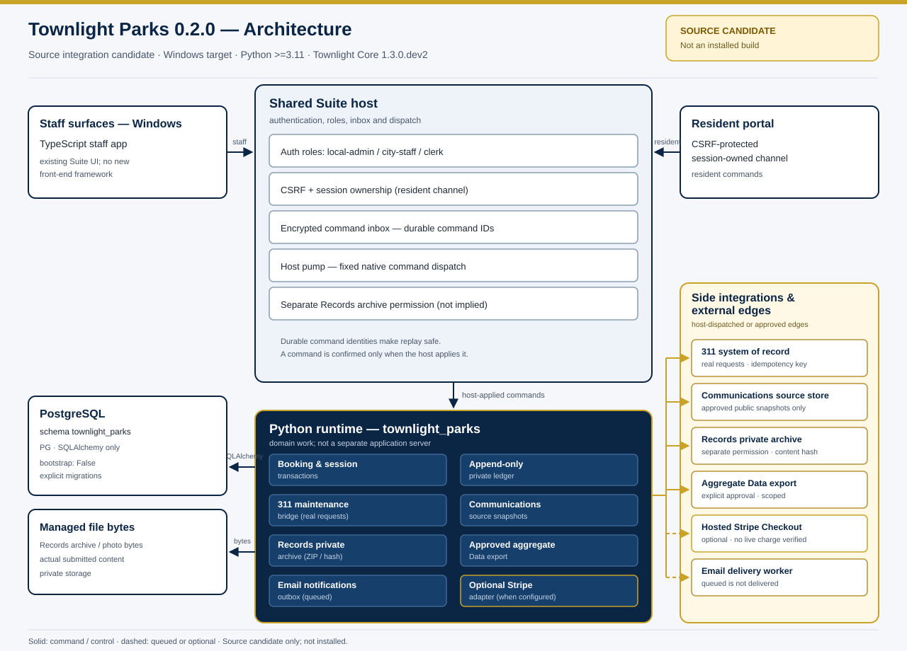
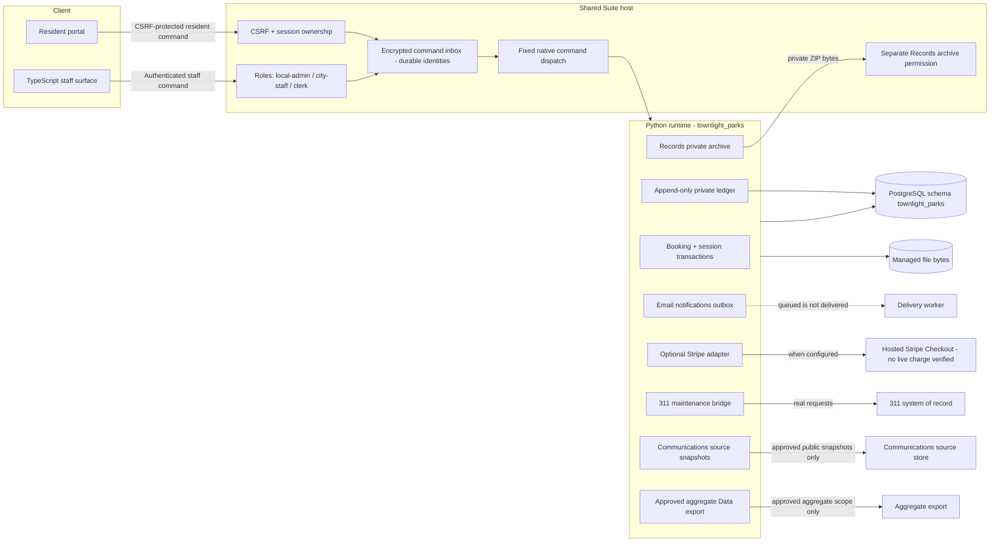

# Townlight Parks 0.2.0 — Architecture Notes (Source Integration Candidate)

**Status:** These notes describe the `townlight-parks` 0.2.0 **source integration candidate** (`import townlight_parks`) against Townlight Core `1.3.0.dev2`. They do **not** assert an installed build, a signed installer, a download, or production acceptance. The existing public Windows release `1.9.3.2` does **not** include Parks, and the final signed combined Suite candidate remains pending.

---

## 1. Runtime shape

Townlight Parks is a Python runtime package layered into the existing Townlight Suite. It is not a separate application server and does not introduce a new platform.

- **Staff surfaces:** existing TypeScript staff application, served through the shared Suite host. Parks adds no new front-end framework and no new host process.
- **Runtime:** Python package `townlight_parks`, target `townlight-core==1.3.0.dev2`.
- **Persistence:** PostgreSQL through SQLAlchemy, in schema `townlight_parks`. Production bootstrap is `False`; tables exist only after explicit migrations.
- **Host integration:** the Suite host owns authentication, roles, the shared encrypted command inbox and the shared native command dispatch used by 311, Communications and Parks alike.
- **Resident path:** the resident portal submits commands over the shared CSRF-protected, session-owned channel; the host enqueues them into the same encrypted inbox that staff commands use.
- **External edges:** optional hosted Stripe Checkout adapter, real 311 maintenance submission, Communications source snapshots, Records private archive bytes, approved aggregate Data export, and an email notifications outbox.

Nothing in this document should be read as an installed-system diagram. It is a source-level description of intended composition and existing Suite conventions.

---

## 2. Component view

The host is the authority for admission, identity and dispatch. The runtime performs the domain work. Durable command identities in the inbox make replay safe; the runtime is not confirmed to have applied a command until the host applies it.

---

## 3. Schema and data ownership

All Parks domain tables live in schema `townlight_parks` in PostgreSQL and are accessed only through SQLAlchemy models. The migration module creates and validates them; there is no runtime bootstrap path.

At source level the schema is organized around these record groups:

- **Resources** — facilities and other reservable or schedulable units, with explicit timezone, setup/cleanup buffers and availability rules.
- **Households** — private grouping of participants, with contact and accommodation data held privately and never exposed by public responses.
- **Bookings** — facility reservations, single or recurring, with approval, reschedule, cancel, closure/blackout interactions and buffer application.
- **Sessions** — program sessions with eligibility rules, capacity, rosters and attendance.
- **Capacity** — the atomic occupancy/enrollment counters that must change in the same transaction as the validity checks that justify them.
- **Ledger** — the private, append-only payment and refund ledger in integer cents with explicit currency, staff actor and reference.

Constraints that matter architecturally:

- Booking overlap checks, buffer checks, closure checks and occupancy writes happen in one transaction.
- Session eligibility checks, capacity checks, enrollment writes, waitlist promotion and attendance check-in follow the same transactional discipline.
- Recurrences are all-or-nothing; a partial recurrence is not left behind.
- Locks are taken in a stable order so concurrent commands cannot deadlock.
- Capacity and occupancy counters are not maintained by a separate background process; they move atomically with the command that changes them.

Public read surfaces project only catalogue and availability. Household, participant, minor, accommodation, contact, private tracking and attachment detail are not part of those projections.

---

## 4. Commands, inbox and resident protection

Parks reuses the Suite's shared command proof and allocation-receipt pattern used by 311 and Communications.

- Resident commands pass CSRF checks and session-ownership checks before entering the inbox.
- Staff commands pass shared host role checks (`local-admin`, `city-staff`, `clerk`); Records archive access is gated by a separate permission and is not implied by any staff role.
- The inbox is encrypted at rest and carries durable command identities, so a retried submission does not create a second booking, enrollment, payment, refund, attendance record or maintenance request.
- A command is not confirmed until the host applies it. Queue state alone is not evidence of completion, delivery or settlement.
- Command dispatch uses the Suite's fixed native command set; this candidate adds no new protocol, endpoint family or transport.

---

## 5. Booking and session transactions

Booking and session commands execute against the same PostgreSQL transaction that validates them.

1. Load the resource or session context, including timezone.
2. Acquire locks in a stable order over the rows involved (resource/session and related occupancy or capacity rows).
3. Resolve stated local clock times to instants in the resource timezone, including across DST transitions, before applying buffers and closures.
4. Evaluate conflicts, buffers, closures/blackouts, eligibility and remaining capacity.
5. On success, write the booking/session change and the corresponding occupancy/capacity change in the same transaction.
6. On failure, return a clear resident-facing error that names the failed constraint and a revision path; leave no partial writes.

For recurring bookings, the whole recurrence is accepted or rejected. Reschedule and cancel are validated with the same discipline as creation, and a cancel releases the occupied windows in the same transaction that records the change.

Waitlist promotion runs against real remaining capacity under the same locking discipline. A retried promotion can not exceed capacity or duplicate a promotion.

Attendance check-in is idempotent per attendee and session.

---

## 6. Payments and ledger

All monetary values are integer cents with an explicit currency.

- **Offline payments and refunds** are appended to the private ledger with staff actor and reference. History is append-only; corrections are made with opposite entries.
- **Optional hosted Stripe Checkout** is a when-configured adapter. In this source candidate no Stripe account is configured and **no live charge has been verified**. When configured, the host creates a Checkout session for a specific obligation, and after the resident completes Checkout the host retrieves the provider transaction and verifies transaction identity, amount, currency and obligation identity against its own records before any ledger entry is appended.
- Provider return URLs are not payment proof. A cancelled or interrupted return is not evidence of payment. Card data does not enter Townlight; only provider identifiers and verified amounts are stored.
- Ambiguous provider outcomes are reconciled before retry. Payment intents and refund intents persist across restart, and a resumed intent is not treated as settled until the host re-verifies with the provider.

The ledger is private: it is not projected to public pages and is not part of aggregate Data exports.

---

## 7. Maintenance links and 311

Maintenance links create **real** 311 requests. Each link carries a durable idempotency key, so a retried submission does not create a duplicate request. The recorded location and photo bytes are the actual submitted bytes, and the returned 311 request identity is stored with the link. The 311 system remains the source of truth for the request lifecycle; Parks does not assert a status that 311 has not returned.

---

## 8. Communications snapshots

Parks can emit Communications source snapshots only for material that has been explicitly approved for publication, such as approved public closures and program descriptions. Snapshot creation is a host-dispatched command subject to the same durable command identity rules as other Parks commands. Non-public household, participant, accommodation or contact detail is not part of a snapshot.

---

## 9. Records archive

Records archive access is a private ZIP archive/readback path over managed file bytes and is controlled by the separate Records permission, not by `city-staff` or `clerk`. Archive review is identified by the exact content hash of the reviewed bytes rather than by a filename or a description. Archive contents and hashes are not exposed to public pages or to aggregate Data export.

---

## 10. Data export approval

Aggregate Data export requires explicit approval: a discrete action that records who approved the export and the aggregate scope that was approved. The export is restricted to that scope and excludes participant, contact and accommodation detail. Approval is not implied by any staff role.

---

## 11. Notifications outbox

Notifications are written to an outbox as queued items. **Queued is not delivered.** Delivery is a separate worker step, and the presence of a queued row is not evidence that a resident received anything. Retried delivery work is expected to be safe against duplicate commands because of the durable command identities, but the host must still apply the work before it is confirmed.

---

## 12. Migrations and bootstrap

Production bootstrap is `False`. There are no auto-created tables and no migration CLI in this candidate.

Schema readiness is achieved programmatically through the package migrations module: `migrations.upgrade(engine)` followed by `migrations.assert_ready(engine)`. Deployment code is expected to call those entry points from its own procedure; `assert_ready` fails closed if the schema is not ready. This document does not invent command-line syntax, endpoints or provider APIs.

Database credentials and hosted payment secrets are configured outside source control and never placed in configuration files, logs or the repository. Profile encryption keys are held encrypted and are likewise kept out of source control, logs and the repository.

---

## 13. Legacy standalone entry point

A standalone `main.py` is retained as a foundation/demo entry point. It is explicitly **distinct** from the Suite architecture described above:

- It is not the Suite authentication path.
- It is not a normal installer.
- It is not the ordinary city-staff deployment route.

Ordinary city staff use the upcoming Suite candidate. The standalone entry point exists for foundation/demo purposes only and should not be read as the production composition of Parks.

---

## 14. Backup, restore and restart

Back up the database, managed files, portal inbox, profile encryption keys and publisher queue **together**, so the relationship between durable command identities, ledger entries and queued work is preserved. On restart the runtime reopens durable requests and resumes known-safe jobs without duplicates. Resumed work is not by itself evidence of delivery or provider settlement; the host re-verifies those before they are treated as confirmed.

---

## 15. Non-claims

- These notes do not claim an installed build, a signed installer, a download, or production acceptance.
- The public Windows release `1.9.3.2` does not include Parks; the signed combined Suite candidate is pending.
- No live Stripe charge has been verified in this candidate; the adapter is optional and when-configured only.
- Queued notifications are not delivered notifications.
- No API, endpoint, CLI or provider interface is invented here; only existing Suite conventions and the stated migration entry points are described.
- No platform expansion is proposed: the target remains Windows with Python `>=3.11` in the existing Suite.
