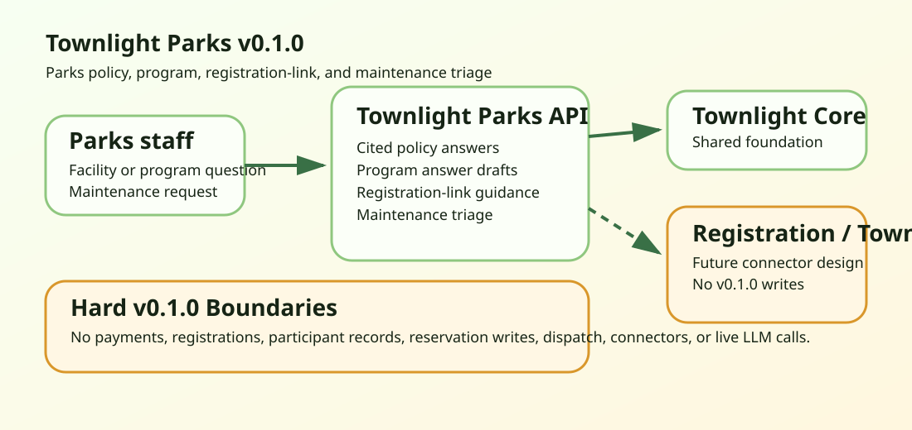

# Townlight Parks Architecture

Townlight Parks v0.1.0 is a deterministic FastAPI module over Townlight Core. It supports parks policy answers, program and facility questions, registration-link guidance, and maintenance request triage while explicitly avoiding payment processing, participant records, registration writes, facility reservation writes, crew dispatch, live connectors, and live LLM calls.

## Shipped

- Parks policy and facility-rule answer drafts with citations and staff-review language.
- Program and event answer drafts with accessibility review prompts.
- Registration assistance that links to existing systems without writing to them.
- Maintenance request triage with Townlight 311-style handoff categories and staff review.
- Public sample UI and release gates.

## Not Shipped

- Payment processing, registrations, enrollments, or participant records.
- Facility reservation writes.
- Work-order creation or crew dispatch.
- Replacement for RecTrac, CivicRec, Townlight 311, or another system of record.
- Live parks connectors.
- Live LLM calls.
